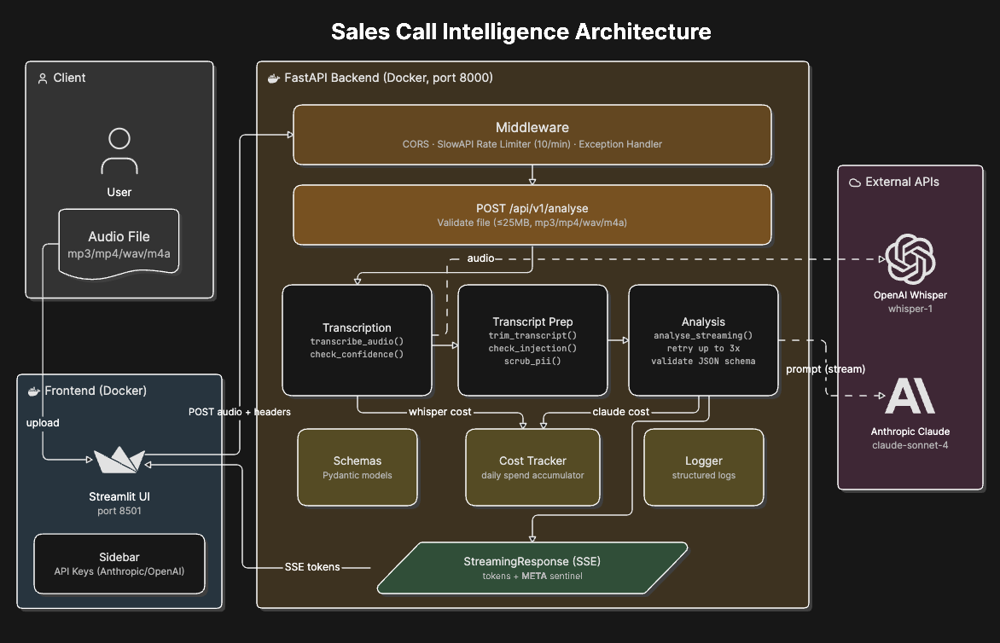

# Sales Call Intelligence

Upload a sales call recording and get a structured analysis — objections, action items, sentiment, and executive summary — streamed token by token from Claude as it arrives. Built on OpenAI Whisper for transcription and Anthropic Claude Sonnet for analysis, with a FastAPI backend and a Streamlit dashboard.

---

## Live Demo

**[https://huggingface.co/spaces/raguram3398/sales-intelligence](https://huggingface.co/spaces/raguram3398/sales-intelligence)**

You need two API keys to use the demo — enter them in the sidebar when the app loads:
- **Anthropic API key** — from [console.anthropic.com](https://console.anthropic.com)
- **OpenAI API key** — from [platform.openai.com](https://platform.openai.com)

Keys are sent as request headers and are never logged or persisted.

---

## Architecture



The pipeline runs in one HTTP connection. Audio goes in, tokens stream out live, and a `__META__` sentinel carries the validated structured result at the end — no second request needed.

**Flow:** Audio upload → Whisper transcription → confidence check → injection guard → PII scrub → context trim → Claude streaming analysis → Pydantic validation with error-fed retry → `__META__` sentinel → Streamlit renders structured output.

Both external calls (Whisper and Claude) are marked explicitly in the diagram. Nothing below the PII wall ever sees raw transcript data.

---

## Analysis Stats

Averaged across two live test runs — a 5m 32s call (332 seconds) and an 8m 50s call (530 seconds):

| Metric | Call 1 (5m 32s) | Call 2 (8m 50s) | Average |
|---|---|---|---|
| Whisper transcription latency | 17s | 18s | 17.5s |
| Claude analysis latency | 8s | 13s | 10.5s |
| Whisper cost | $0.036000 | $0.054000 | $0.045000 |
| Claude cost | $0.008400 | $0.013512 | $0.010956 |
| Total cost per call | $0.044400 | $0.067512 | $0.055956 |
| Test coverage | — | — | 95% (323 statements, 16 missed) |
| Tests passing | — | — | 35 |

Whisper bills per minute rounded up. Call 1 = 6 billed minutes, Call 2 = 9 billed minutes.

**PII scrubbing — tested against a transcript containing explicit contact details:**

| Entity type | Count |
|---|---|
| EMAIL | 12 |
| PHONE | 3 |
| CARD | 1 |
| AMOUNT | 11 |

27 PII entities scrubbed correctly across one transcript. The first test transcript used written amounts ("eighteen hundred dollars") which the regex correctly does not match — `$` notation is required for the `AMOUNT` pattern to fire.

**Whisper WER:** Not measured. `jiwer` comparison was not built — see "What I did not build and why." The confidence check uses a consecutive-repeated-word heuristic as a proxy and flags transcripts where repeated words exceed 30% of total word count.

---

## Project Structure

```
sales-intelligence/
│
├── pyproject.toml
├── README.md
├── .gitignore
├── .env
├── .env.example
├── .dockerignore
├── dockercompose.yml
├── Dockerfile
├── requirements.txt
├── streamlit_app.py
│
├── .github/
│   └── workflows/
│       └── ci.yml
│
├── docs/
│   ├── architecture.png
│   └── original_transcript.txt
│   └── structure.txt
│
├── tests/
│   ├── test_routes.py
│   ├── test_analysis.py
│   ├── test_cost_tracker.py
│   ├── test_pii_scrubber.py
│   └── test_transcription.py
│   └── trial_scrubber.py
│
└── src/
    └── sales_intelligence/
        ├── main.py
        ├── api/
        │   └── routes.py
        ├── services/
        │   ├── analysis.py
        │   ├── transcription.py
        │   ├── pii_scrubber.py
        │   └── cost_tracker.py
        ├── models/
        │   └── schemas.py
        └── utils/
            ├── logger.py
            └── exceptions.py
```

---

## Running It

**Docker (recommended):**

```bash
cp .env.example .env
# Add your ANTHROPIC_API_KEY and OPENAI_API_KEY to .env
docker compose up
```

FastAPI runs on `http://localhost:8000`, Streamlit on `http://localhost:8501`.

**Local:**

```bash
pip install -e ".[dev]"
uvicorn sales_intelligence.main:app --reload --port 8000
streamlit run streamlit_app.py
```

**API keys:** You can also pass keys directly in the Streamlit sidebar without touching `.env`. They're sent as request headers (`X-Anthropic-Key`, `X-OpenAI-Key`) and are never logged or persisted.

---

## Running Tests

```bash
pytest tests/ -v --cov=src
```

35 tests across five files. Covers: prompt registry regression, JSON extraction, retry logic (success on attempt 1, success on attempt 2, exhausted after 3), cost accumulation and daily threshold alert, PII scrubbing, injection detection, route validation (extension, MIME type, file size), pipeline guards (injection in transcript, Whisper timeout), happy path with `__META__` sentinel, low-confidence flag propagation, cost logged with request ID, Whisper cost calculation, confidence heuristic, transcription happy path and timeout, and `_get_client` key priority in both services.

---

## PII Policy

**What is scrubbed before Claude and before logging:**

- Email addresses → `[EMAIL]`
- US phone numbers (with or without country code, all common formats) → `[PHONE]`
- Credit card numbers (13–16 digit sequences) → `[CARD]`
- Dollar amounts (`$1,800`, `$1.2M`, etc.) → `[AMOUNT]`

**What is not scrubbed and why:**

Name detection was removed from the final build. Title-cased regex (`[A-Z][a-z]+`) cannot reliably distinguish personal names from company names, product names, and locations without an NLP model. Applying it introduced too many false positives on normal business language. In production, name detection would use spaCy's named entity recognition with the `en_core_web_sm` model to detect `PERSON` entities specifically.

**What is never logged:**

The raw transcript never reaches the logger. The logger receives only: `request_id`, `transcript_chars` (character count, not content), `duration_seconds`, `amount_usd`, `daily_total_usd`, and event names. No transcript text, no scrubbed output, no PII of any kind.

---

## Production Bar

| # | Requirement | Status |
|---|---|---|
| 1 | Async FastAPI — rate limiting (10 req/min via slowapi), Pydantic validation, `/api/v1/` versioning | ✅ |
| 2 | Structured output with error-fed retry — never crashes on malformed JSON | ✅ |
| 3 | Prompt versioning — `PROMPT_REGISTRY` with `v1` baseline regression test | ✅ |
| 4 | Context window budgeting — character-estimate trimmer at 150K token budget | ✅ |
| 5 | PII scrubber — emails, phones, card numbers, financial amounts scrubbed before Claude and before logging | ✅ |
| 6 | Input sanitisation and prompt injection mitigation documented in README | ✅ |
| 7 | Timeout on every external call — Whisper (60s) and Claude (60s), both tested explicitly | ✅ |
| 8 | Cost tracking per request — logged with `request_id` on every Whisper and Claude call | ✅ |
| 9 | Daily spend alert — warning logged once when cumulative spend crosses $1.00 | ✅ |
| 10 | Pytest — 35 tests passing including retry, PII, injection, cost, and timeout tests | ✅ |
| 11 | Streaming to Streamlit UI — token-by-token display with partial JSON progressive rendering | ✅ |
| 12 | Dockerized — multi-stage build, `docker compose up` starts both services | ✅ |
| 13 | GitHub Actions CI — ruff + black + pytest on every push to master | ✅ |
| 14 | Deployed to Hugging Face Spaces — live URL in README | ✅ |
| 15 | README written on ship day with real latency numbers, cost per request, PII policy, architecture diagram | ✅ |
| 16 | Whisper low-confidence handling — consecutive repeated word heuristic flags low-confidence transcripts before Claude analysis, surfaced in Streamlit UI | ✅ |

---

## What I Did Not Build and Why

**1. Anthropic token counting API call before each Claude request.**
I implemented character-based estimation (`len(transcript) / 4.0`) to check against the 150K token budget. I did not call `client.messages.count_tokens` because the character estimate is sufficient for a single-user demo and avoids an extra API call — and therefore extra latency and cost — on every request. In production I would call the token counting API before any request where exceeding the context window would cause a billing or quality failure.

**2. Name scrubbing via regex.**
I built and then removed a title-cased regex name scrubber after it produced too many false positives on normal business language (company names, product names, city names). I documented the limitation rather than shipping unreliable scrubbing. In production I would use spaCy's named entity recognition with the `en_core_web_sm` model to detect `PERSON` entities specifically.

**3. Whisper word error rate measurement via `jiwer`.**
The confidence check uses a proxy heuristic — consecutive repeated words — rather than true WER comparison against a reference transcript. I did not build `jiwer` comparison because generating reference transcripts for arbitrary audio uploads requires either manual transcription or a second, higher-accuracy transcription model, which is out of scope for a demo. In production I would maintain a test set of reference transcripts and run `jiwer.wer()` against Whisper output on each deployment to catch model regressions.

---

## Known Limitations

- **Injection guard is pattern-based only.** Five hardcoded phrases are checked case-insensitively. A sophisticated adversary who avoids those exact phrases will pass the guard. This is documented as partial mitigation, not a solution. The real protection is that the system prompt is never constructed by concatenating raw user input — the transcript is inserted only into the `user` role content.

- **`_daily_spend` resets on process restart.** The daily accumulator is a module-level float. It does not persist across container restarts or deployments. In production this would be written to PostgreSQL on every `record_spend` call and read back on startup.

- **Streaming endpoint has no rate limiting on the SSE connection itself.** The `POST /analyse` endpoint is rate-limited at 10 requests per minute per IP. The streaming generator that runs inside that response is not independently rate-limited — it is bounded by the outer rate limit.

- **PII scrubber does not catch non-US phone formats.** The regex covers US numbers with and without country codes. International formats (UK, EU, AU) are not matched. For a global deployment, the phone regex would need to be replaced with a library like `phonenumbers`.

- **Name detection is not implemented.** Personal names in transcripts are not scrubbed. This is documented explicitly in the PII policy section above.